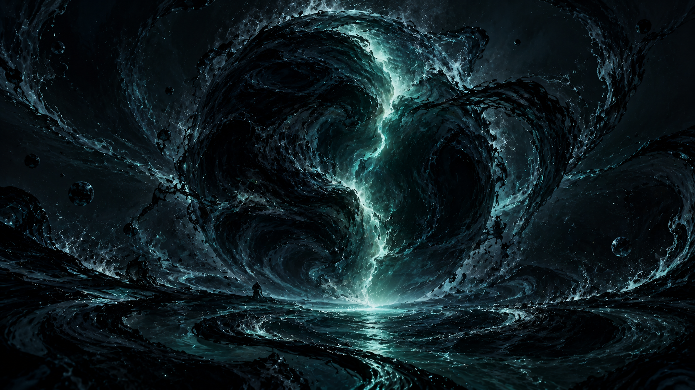
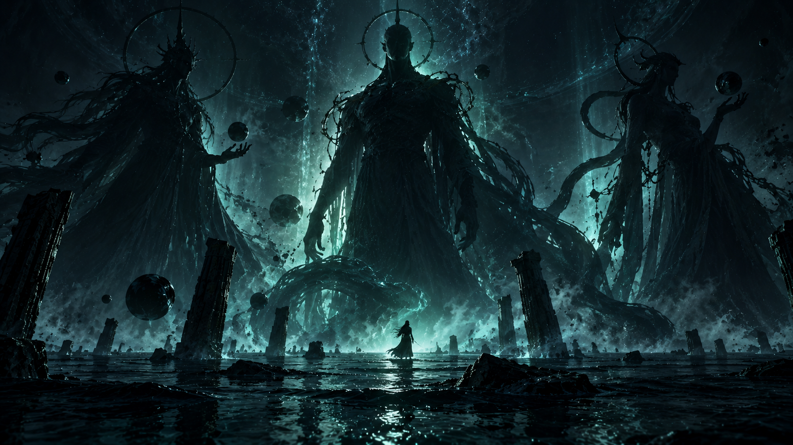
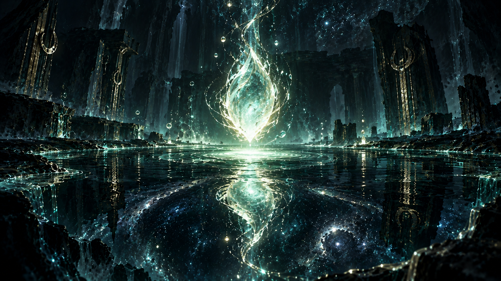
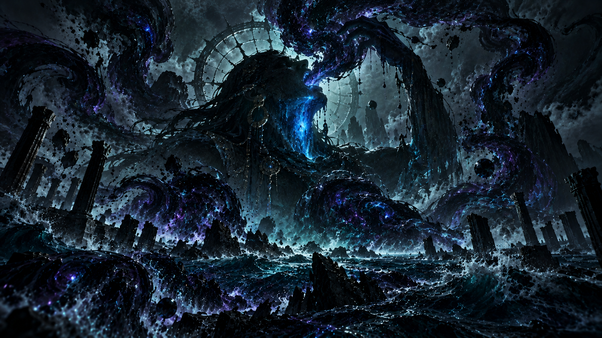
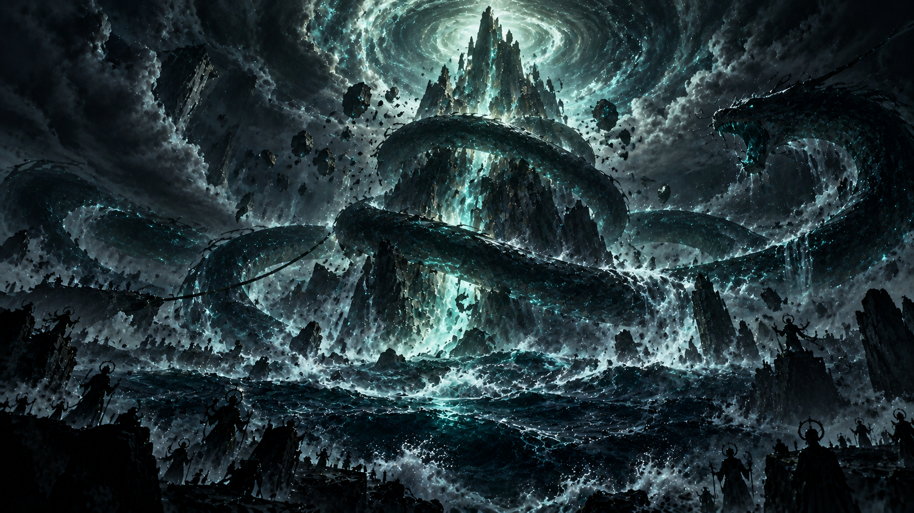
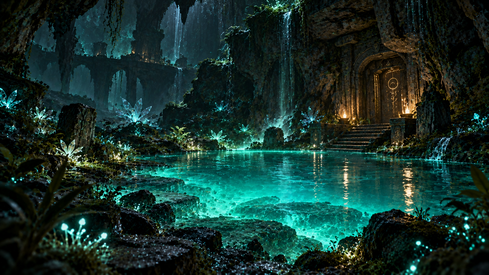
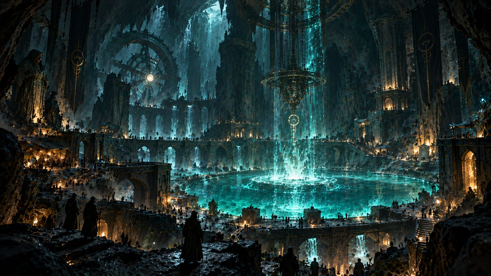
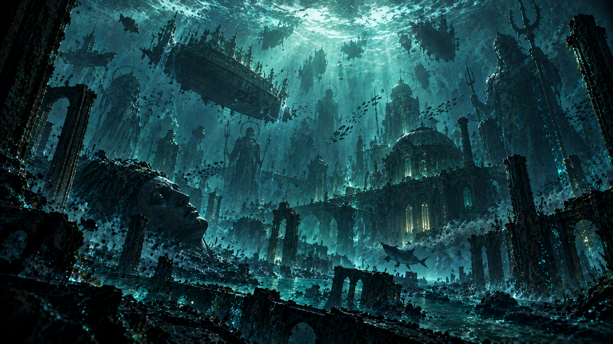
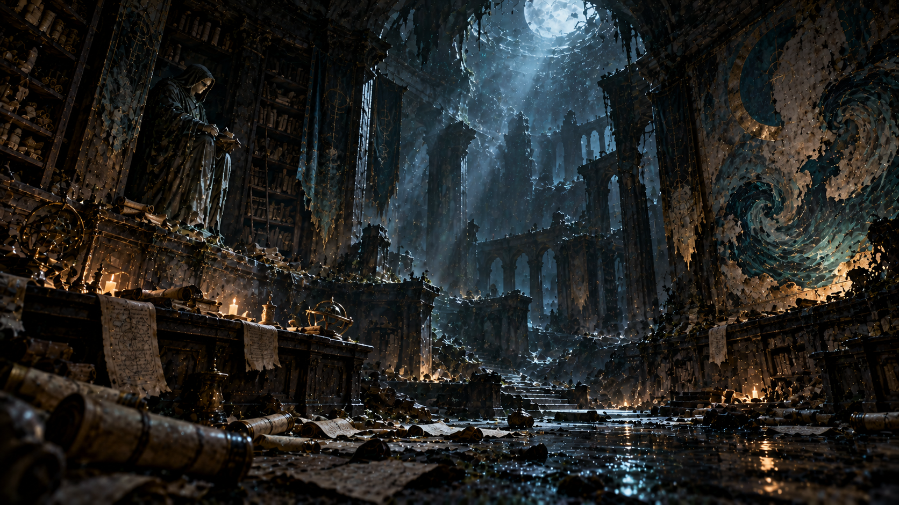
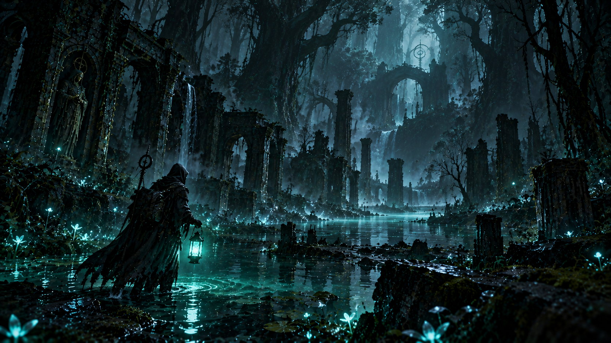

# Niyumei — Complete Lore (current state)

Compiled 2026-10-07 from src/content/lore/. Drop lore-update.md in the repo root with new/changed entries and ask me to sync.

---

# The First Ocean

## Ādi-Sāgara

*The First Ocean - the primordial medium from which reality condensed*

> “The sea did not rise. The world descended into it.”
> — Inscription, western stele of the First Vāra

There was a time, the old songs insist, when the world did not have land in it at all. No coastlines. No mountains rising. No one walking along a shore and turning back to say *it is bigger than we thought.*

What there was, the oldest fragments call **Ādi-Sāgara** — the First Ocean.

But don't picture water. Picture the *idea* of water, repeated until it became a place. A medium underneath everything, spread wide and slow and thinking nothing in particular, from which mountains and forests and people eventually condensed the way frost condenses from breath. The Firstborn fished in it. Later faiths waded into it. Nobody ever saw to the bottom, and nobody ever agreed where its edge was, because the only edge worth an edge was the one it made around the world.

Each culture kept its own name for it, the way sailors keep their own word for weather. The West called it the Deep. Some texts settled on the Sea Beneath the Sky. The scriptures of the Weeping Forests insisted it was simply Nammu — *the mother of everything*. One half-rotted tablet, recovered from the belly of a Third Vāra, simply bears the word *Akasha* and a single tide-mark, as if the writer had run out of century.

> Here is the part that frightens the Order's historians: those words were not borrowed. They were *remembered*.

Whatever sank out of that first medium, it left one fact behind it — a fact every civilization ever to stand on this earth arrived at on its own. The world was not always there. The world was *let in*.

---

## Prakāśa and Tamas

*The first distinction, and the law of cosmic order*

> “Light made things. Dark let them finish. Order kept the books.”
> — Primer of the Vallum Wardens

Out of the nothing came the first difference, and the difference had two parents.

**Prakāśa** — light, revelation, the moment a thing becomes *something you can see*. **Tamas** — darkness, obscuration, the moment a thing finishes being seen and returns to the general club of what is.

They were not good and evil. That shorthand belongs to later cults, and every Temple Archivist knows it loses something. Prakāśa lets a thing be and stay be. Tamas gives it leave to end, to rot, to fall out of the census and into the telling. Prakāśa produces the name of a thing. Tamas lets the name retire.

Between them sat the law the early priests called **Ṛta** — order. Not a ledger, not a boss, not a god: a *cadence*. The agreement by which the day came out of the night, the wake out of the ship, and the ship, sooner or later, out of the water. As long as the exchange stayed even, the world could be *a world*. Ledger full, ledger cleared, and next page.

The moment it swerved, none of the old certainties knew what page they were on. Then came the Mahā-Manthana.

---

## The Firstborn

*The beings that came before humanity*

> “They did not make the light. They taught the dark to answer.”
> — Varna of the Choir, Fragment of the 4th Record

Before anyone had ever needed a word for god, something walked this world that fit. The old tablets disagree about what it was, and after enough millennia, one starts to suspect they agree more than they admit: Devas. Anunnaki. Atua. Titans. Jotnar — the cold giants, the old law of the North. The survivors of the first villages called them, simply, *the Firstborn*, which is the only honest answer.

They were not bare. No beast, no army, no chief of spears. They operated at the scale under scales, which is inconvenient for anyone who wants to carve a statue.

What they had was **Siddhi** — the oldest word for capability, which meant something more particular than our word suggests. It meant the world answered to them. They could press a palm to the weather and change its mind. They could walk into a dream and rearrange the room while the dreamer slept. They could stand in the middle of the world and pull on it until the wound closed.

And they could reach down, past the crust, and touch Ādi-Sāgara.

## What we cannot know

Here is the honest position in the scholarship: we do not know if the Firstborn were many nations, many species, or one thing wearing many names because there was no one around to pronounce a better one. The tablets were written after the event by people who were already badly scared. It is entirely possible that the argument over *which* name is correct is exactly what the Firstborn wanted to leave behind them. An argument, like a wound, heals over and hides the shape of what made it.

What the archives can agree on, and what no culture disputes: they were not like us, they were here first, and they had their hands on the machinery of the world. One day, they gave it a turn they could not take back.

---

## Amṛta

*Potential itself — the regenerative principle of existence*

> “Amṛta is not deathless. You are. Amṛta only borrows you back.”
> — Sūtra of Varna, the Undying Fragment

Ask a hundred priests what would be found in the heart of the First Ocean, and you will collect a hundred soft answers — *life*, *light*, *the seed of all things* — and none of them will be wrong, and none of them will be specific enough.

What was down there, according to those who later claimed to have touched it, was called **Amṛta**.

Our word for it — *elixir of immortality* — is a lie told by people who missed the point on the way home. Amṛta was never a drink and never a treasure. It was the principle by which the world keeps starting over: the spark that makes the broken heal, the rain outliving the riverbed, the morning after the shipwreck. **Potential itself.** The raw argument from disorder to possibility.

The Firstborn read it the way you would read a weapon's handle. *If we can pour enough of this into ourselves, we stop being limited by keeping alive. We become unlimited. We become forever.* They wanted a cup of the ocean's underside, and a way to carry it home. They got a Kun.

> The Order's Archivists maintain the harder reading, the one the hill-priests refuse to copy down: you cannot own the principle of renewal, you can only *lend yourself to it*. Everybody thinks Amṛta granted deathlessness. The real transaction ran the other way.

---

---

# The Churning

## The Blue-Throated Guardian

*The being who contained Hālāhala — partially*

> “I drank so that you might breathe. Do not thank me. Remember me.”
> — Last Testament of the Blue-Throated Guardian, Nīlakaṇṭha Cycle

The version the temples know is too polite. A god swallows the poison, the world is saved, everyone goes home.

What the Order's historians spread across their long black tables is less tidy. Among the ranks at Mandara, one of the Firstborn decided the poison in the air was not a message to be read but a body to be contained — and that the only container available was themselves. **Śiva**. The Nīlakaṇṭha. *The Blue-Throated*: a title, not a name, and it was written on them like a wound. They walked into the open air and they drank.

That much is true. So is what Section Twelve of the Record insists on, in the margin every sanctuary cult has been caught copying out: they did not swallow the poison and take it away. They swallowed it and *kept* it. The contents had to be held, sealed off from the world below, and the only vessel on hand was the throat of the one who caught it.

The blue neck was the cost of the lid.

## What spilled

The containment was a success *only in the arithmetic one can argue with* — one shoulder had been pushed through the passage, one side of the line had been missed. A fraction of Hālāhala washed past before the last door of them was sealed. It is in the soil of the Weeping Forests, in the corners of the drowned cities, in the map-edges the Third Vāras stopped walking. That one swallow was the beginning of every monster the archives have a name for.

The texts offer competing endings for the Guardian. The western cache says they held the lid on the underside of the world until it broke in their hands, and a final record from the Drowning period says they were brought down with the country, and were part of it. A northern keeper's note, slipped between the Census Records of the Guardians, claims the throat stayed blue because the poison never sealed its last joint, and that the only account of the closing spoken anywhere came from a boy who stood by the seas and simply observed that the tide kept asking something of the water.

> The sanctuary prayer, offered over the wells each long month, is not a blessing. It is a ledger entry. *Offer to the Blue-Throated, and the wells stay what you remember them to be.* The Order's copy-editors say there is nothing supernatural in what that phrase protects. The Guardians say there is nothing supernatural in anything. Neither of them is looking in the right direction.

---

## The Mahā-Manthana

*The Great Churning — when the mechanism failed*

> “The mountain refused. We held the rope anyway.”
> — Chorister's Ledger, Mandara Expedition

They built it the way you would if you were drunk on your own name.

A mountain — **Mandara**, they called it — rooted so deep it found the underside of the world. Its peak pointed at Ādi-Sāgara the way a well points at sky. And coiled around it, wrapped fifty times around the slope, a serpent called **Vāsuki**, thick as a wall, and the Firstborn pulled.

Nobody wrote down what they were pulling for in the minutes of that project, because nobody needed to. The archive says what we can't *not* repeat: they wanted Amṛta. *The Deathless. The bottomless cup. Ours.*

For an age they got treasures — chalices, gardens of impossible crop, strange and disconnected wonders out of the primordial, each with someone's face on it and someone's cult behind it. For an age, it worked.

Then came the part everyone drew with their mouths closed. **Hālāhala** came up with the treasure. The poison. The sea's sickness sat on the table with the prizes.

And then the mountain slid.

## How it broke

The tablets do not fail you here; they disagree *exactly the same way everywhere*. The western one says the serpent simply could not hold the weight in the length of its hold. The southern text says the mountain climbed down of its own accord, which might be a metaphor, unless it isn't. The Fragment of the 4th Record, safest of the caches, just says: the line gave way.

What came up then had no name, so they named it later with a sigh they were still spelling out a hundred years on.

**The Mahā-Pralaya.** The Great Dissolution. Not the end of anything, so much as the reset. The old country finished paying for its lease, and something new was *let in on the same site.*

> Every account of the Churning ends here before it ends the world, which is the Way of accounts. The Churning didn't destroy the old map. It turned it over half-finished, and what history was written underneath is still being read.

---

## Hālāhala

*The poison that came out of the Churning — accumulated entropy*

> “The poison was not a punishment. It was an apology the ocean did not know how to say.”
> — Ayat, Keeper of the Seeping Wells

Nobody in Mandara's ranks had a jar for what came up second. It oozed over the table and into the cups they had ready for it: Hālāhala.

It was not poison in the kitchen-grinding sense — a dose, a stopper, a cure that is in someone else's hands. It was the ocean's *leftovers*. Every ending the world had ever executed — every failed garden, every kingdom that proposed a map and was then swept out of the room, every child who never got to be argued about, every story that was interrupted at exactly the wrong line — had been filed somewhere. The Churning pulled the files up out of the basement. **Hālāhala was the filing.**

And it had nowhere to be put back.

## What it did, once it was in the air

You could not describe it afterward, which is how it knows how to find you back. Forests reached out of the ground overnight and found each other. Dead things came back bearing a note in a handwriting no one's mother wrote. Whole rivers reversed their opinion. A town in the southern reaches awoke one morning every winter and called the other seasons summer.

The Order maintains that these were not attacks. They were *echoes* — the old possibility wars deferring to a new referee. Later generations named what rose out of them **monsters**, which is one way of being wrong.

But some of it reached the corners of the world and simply *stained* them — no forests, no movement, no story. Only the flat, ink-toned notion that this place should not have been asked anything. These tracts became the Ashen Expanse, the Barren Lines, the map-edges of every Vāra's first audit. Hālāhala does not poison. It *refuses*, and the refusal has weight.

---

---

# The Drowning

## Kuns

*Scars left by the Churning — small bodies of water infused with Amṛta*

> “A Kun is not a pond. It is the world's scar that heals by giving.”
> — Sister Veya, Warden of the Glowing Wells

Once the water went down, it did not all go down the same way. Where the ocean had soaked the land, and where something of the churned-out Amṛta had washed into the hollow of a drowned forest or a collapsed temple court, the two refused to leave a simple pond. They made something else.

A **Kun**.

You would know one by its light first — a faint, slow-meaning teal in the dark, usually about a few feet off the water's floor, as if the pool were remembering noon. The plants that grow around it are wrong, but in the way that new blood plants are wrong: the same direction, a different palette. Animals crowd the verge who do not belong in one place. In the drowned sector, the fish sway the wrong way in the current, as if the water itself is offering to borrow one of their complaints.

More importantly — people will swear to this you have heard your whole life without ever asking for the literal meaning — wounds from fighting with a Kun's water in them do not run a fever. Crops draw water, and leave no famine. Hold your hand near the level and watch the small platelet of current resist the shape of your fingers. The older faith interprets this as *giving*. The Order's epidemiologists call it *a strong response to an unusual consensus of light*.

> A Kun is not a pond. It is the world's scar that heals by *giving*.

The truth the sanctuary has not quite grown into: every Kun in the world carries the same teal color, the same slow light, and the same reluctance to show its bottom. It is deep enough to hide one of the numbered stones.

---

## Vāra

*The hidden refuges — massive underground sanctuaries built around Kuns*

> “We sealed the door against the sea. Later we forgot we had a door.”
> — Excavation Note, Vāra 12

The people of the Drowning knew two things: the water could be survived, sometimes, and the water could not be trusted. So their great, generational act of architecture responded to both with the same heavy tool.

They built **Vāra**.

The shape of every Vāra that has been excavated follows the same parable that the refuge's own blue-throated fresco has always told: a lowered ring, a reservoir at bottom, and above it, palace. A city folded backwards, an entire city propped by its own root cellar. Access streets up, everyone knows. But in the plans of the surviving builders, there are streets *down*. Streets the builders took through passages that have since been discovered to reach natural caverns miles below, miles wider than the Vāra's inventoried footprint.

A Vāra means several things, depending on which lecture you attend: a bunker of the drowning, a chapter house for the water-keepers, a private city inside its own auditorium, and the strong room of a drowning people that had made a religion out of being able to close the door.

*Most survived. Most.* Some became cities that forgot the sky for a generation, and, in the words of Ilsabet's Ninth Vāra, described the street that leads up from the long stair as "the wound." Some were *flooded again* and became the stone foundations the sanctuary area believes were always there. Some were deliberately sealed, by their own survivors, against the second flood, because the archives admit there was talk of a second.

> The sanctuary you grew up in is one of these. Its blueprints, the most complete set in the archive, were drafted, then amended, then redrafted with the reservoir moved fifteen feet, and then amended again with a column of water carried into the entry in a note that the Order reads as 《*the entry is safe for floating objects the length of the boat-dock*》. What the water was meant to become *once it came in* is the part of the plan that no complete copy has ever been found.

---

## Regions of the World

*Where survivors scattered, and what each region became*

> “Every map is a mercy. We draw the world as it could be survived.”
> — Karth, cartographer of the Order

The charts from before the flood are the kind of thing the archive keeps in locked sleeves: cities named, measurement posts, gardens. Ask a student the obvious question — *how much of this is under water?* — and the old men in the survey room smile. Not because they know more. Because they know it's a better question than it used to be.

The local tradition splits the surviving world into broad tempers. No two surveys agree, and that is a form of evidence.

## The broad tempers

**The Weeping Forests** — where things return. Trees walk, in the faction's account; animals speak one word of a language whose other speakers have moved elsewhere; and the water that stands in that country carries a slow-color light that the field journals never name the same way twice.

**The Barren Lines** — Hālāhala's oldest foothold. There is no rumor of what happened at their center. Surveys do not return from them, and do not write home afterward. The archive's word for that territory is *closed*, which it usually isn't.

**The Drowned Cities** — the places the Flood kept. Some are still under ocean, and their carvings keep reading the old calendar. The ones that leaked into the sanctuary's drainage plan figure in the fifth reservoir's design — and every night watch that watched thinks it heard something from it.

**The Impossible Lands** — where reality runs on an unknown school of rules. The wells there turn their light with the moon. Fish return south through the air at a walking pace in the local season. The sanctuary allows itself two factions' worth of debate about what that means, though it has never closed the gate on going and looking.

**The Unknown Territories** — the white blank on every chart. The oldest of the Order's maps note, in the last survey's margin, that directly west of the last stone post, the old columns are still standing, and there is a name on one of them. The name is the same as the name the sea has, but older.

---

## The Flood

*The boundary between the ocean and Ādi-Sāgara collapsed*

> “We counted the arks at dawn. By dusk we stopped counting.”
> — Mother Ilsabet of the Ninth Vāra

The survivors of the Churning did not experience the Flood as a wave. It was a merger. The physical ocean — the shallow, familiar, shoreside thing that any fisherman had ever known — and Ādi-Sāgara — the layered, formless, universe-adjacent liquid beneath the first shallows — simply gave up being separate for a time. The boundary gave out, and for a century afterwards, *all water was almost the same water anyway.*

Coastlines stopped meaning anything. Maps became liturgies.

## What it did to the world

The oldest texts don't list the drowned; they list the sounds. River-doors, the western tablet says. Market stone tolling, the third house's hand. The sound of harbors, a thin and carrying noise from the last ship's chronicles — *she calls the dock, she calls the dock, she calls the anc-*

Everything gotwet. Everything was drowned or drenched in the short version of the world.

## What the people did

No ark, if by an ark we mean something that worked. Every culture on this planet seems to have put the same half-built plan into the same sea — stone coffins, stamped dhow, brick ferries, stone doors pulled shut. The plans might not have been that similar, but the taste for listing them in the toll-houses of the sanctuaries was. **Most failed, of course.** But most is doing a lot of work in that sentence.

A few stone cells floated. Some of the drowned became the foundations of settlements that exist on current charts. Some are still leagues under the cold and waiting for a visitor, or for whatever tide-cycle picks it up.

And some — including the one your sanctuary was built inside, the strongest of the survivors — became habitable on their own terms. The Vāras were never declarations of faith. They were the only remaining kind of roof.

---

---

# The Great Forgetting

## The Third — those in the dark

*The civilization nobody talks about*

> “Above the flood we forgot. Below it, we remember.”
> — Unattributed, recovered drift-text

The sanctuary you were raised in does not have a name for the third part of the world. The only word for it in the schoolbooks is *unapproachable*, and it is entered on the margin of the first great map as the blank square in the western edge of the survey, and again two versions of the map later, as a second square directly below the first, labeled with nothing at all.

Whatever the old chronicles claim about the fourth flood, they hold to this part: a significant portion of the civilians who lived through the Flood Period did not flee, did not found a new harbor, and did not sink. They went *down* — one or more decades before the official narrative of the sanctuary's settlement, deeper into the shore, deeper into the stone, into the passage-web whose using they had already been saving for the full argument of the disaster.

This is the problem the sanctuary does not address. **The tunnels that give the sanctuary its drainage have not been inventoried.** The drainage systems written in the First Vāra plans have all been addressed, counted, budgeted, and story-marked, except for *the west cuts*, which reach the bone of the Third House and then do not answer the sounders. Explorer Nicolai Vann's record from the years of the undercount insists — in a script with intervals that the curators cannot read now and do not ever copy in the open room — that the passage's floor is held.

The archivists of the wider sanctuary work on this problem in two lists. One is titled with a name: the inhabitants of the west-end, in the Census of Quarry. The other list has no name, only a drawing, and a number of ticks, and is labeled *the not-in-record*. The drawing is an underground city, viewed at night, with no surface.

## Why no faction

The Guardians do not admit a third faction because to name one is to admit a third surface of the world beneath the wells. The Order does not admit one because to admit one is to admit that there are accounts of the flood that it has not indexed. The sanctuary as a whole does not admit one because to admit one is to admit that its famously complete blueprints have a corner in which it is possible to bury a building.

What has happened in the wells, lately, is an upwell of the old language — the one the samples of the west-end census were written in. The boy from the outer tower insists he can make half of it out now. He reads it more fluently than the archivists, and it is important that you know he is fourteen.

---

## The Great Forgetting

*Humanity didn't merely lose technology. It lost history.*

> “What we buried, we called sacred. What we could not bury, we called weather.”
> — Classic of the Middle Houses

The sanctuary you grew up in does not remember the end of the Flood as a day. It remembers it as a smell.

Something went out of the world in the centuries that followed, and it was not locked. It simply left — like the tide leaving some great, silent harbor, and no one noticing until much later that they had been living on the bare bottom of it. Records fell out of use. Genealogies that had once reached back to the Churning ended after a generation or two, as if nobody had thought it worth writing anyone past grandfather. The last chronicle from the Inner Spiral is a commentary on a corn yield. After that, the pen runs out and nobody bothers to reload the ink the next morning.

The **water-weavers** built the first chronicle vaults, their crust teal-green and their doors ringed with salt. By the third of them, the penmanship had changed, the measurements in the columns drifted toward tradition, and village astronomers began drawing roads to the sky without any roads on the ground going anywhere.

People were not illiterate. They were *inherited*.

## What that buys you

Every culture that ever made the long voyage to the far side kept one of the old answers. *The gods fought.* *The ancestors failed.* *The sky broke.* *The sea ate the earth.* *We were never supposed to survive.* Five pieces. None of them the length of the problem — each believed in every possible combination across the shores, the forests of the Ashen Hollow, and the drowned, parked, extraordinary city.

> The Order keeps a page of the library that says what this costs. It is examined, not destroyed. The page reads: **There is no such thing as forgetting. There is only agreeing on what to forget.**

---

---

# The Present

## Vox

*Those who learned to move through the altered world*

> “If we cannot see beyond the horizon, we cannot protect what lies behind us.”
> — First Teaching of the Vox

The first scouts out of the Second Vāra went down the south stair because no one else would, and across the drowned district because no one else had. What they came back carrying, all those years ago, was not treasure. It was a bearing: a litwell, the first of the glow-lanterns, packed with the famous shimmer of the Wells, set up in the ground between two districts.

From that walking came the idea. The world is altered; the roads were the way out of the trial; so the path is not a detail to be left to cartographers. If things come up, things are coming; the only answer is someone to walk and watch and come back and write it down.

The **Vox** are that someone.

They are, locally, the speech between town and sanctuary — the one who comes home with last season's account, with the count of rooms still inhabited at the collapsed manse, with a ruling on whether the stone at the turn is *wet* (false scoucry) or *not wet* (an easier day's walking tomorrow, if the second watch bears it).

Their affinity is **Glow.** The radiance of the Wells, held in a vial and walked with. A Vox does not carry a long torch or a brazier or what the southern office calls *a signal dispatch in the trenches*. They carry a small sealed lamp between the toes of a sandal, and a word, and the understanding that the lamp is not a light. It is a refusal of the dark.

> A Vox's first note is their own account of the road. The tradition is: *we do not cross until we are named.* The register at the water bench in the sanctuary court, the page the scholarship posts out to the houses of the outer towers, is in the Vox hand — with the one voice the records have never liked to spell correctly. It is the nearest thing to *we went*.

---

## The Order

*The keepers of the oldest records — and their warnings*

> “When the waters begin to move without wind, the Churning has awakened.”
> — Oldest Warning of the Order

The Order has no flag, no gate, no chairman. What it has is a library, and the library is called the sanctuary, and the sanctuary was already built when the Order inherited it. The Order claims to run the schools, which is mostly true, to run the water, which is true some afternoons, and to know more than it is saying, which no one has ever had the nerve to argue with.

Every gatehouse has a membership, which is to say list, on a spring board at the warden: the pensioner who keeps the weight-measure of the reservoir; the water-weaver still apprenticing at the wrong age; the old woman with the mason's brand who writes with the same hand she hits walls with; three boys with no heart; and whatever reader has worked through the first-third survey of the third-layer index this week. Ordinary people get overlain by the Order every day of their lives, and they have stopped noticing. The Order counts this as a win.

## The warning

The third page of its most-copied instruction runs:

> **"When the waters begin to move without wind, the Churning has awakened."**

The Guardians hear this as a metaphor and are content to do so. The Order's graduates do not forget to notice that the sweep schedule on the inner wells has begun to include *night*, specifically every three nights in season, when the weather is still.

And the other piece they put on the desk, the piece no one holds the description of out loud: records from every well, across the world, across the age, rise a little together, at the same rate, in the same quarter, as if the county is breathing. The register of measurements has two columns, and the second one has been struck through by the previous three archivists, in seats that passed them on. Each entry still reads the same steady number.

> What the Order will not write down — and what the archivist can tell you, if the evening is quiet and the lighter is lit — is that the ticking in the wells is becoming a call. At the upper end, the numbers now come in groups of five. The observers who have listened have agreed between themselves that the groups sound similar to the old dialectic the sanctuary lost after the Drowning. Specifically the sentence: *we hear you.*

---

## Vallum

*Those who learned to withstand the altered world*

> “Nothing reaches those who stand behind us.”
> — Oath of the Vallum

The scholarship post lists the moves of the Vallum in a four-column table: *gate claim, gate watch, gate cease, gate bar* — which already tells you most of the philosophy of the thing. The other half of the philosophy is what they do not carry: a light. To be a Vallum is to have tried, once, some long summer ago, to redirect or understand the Hālāhala in the Wells as they came up the roadway, and to have decided that the hour was not that. The hour was the waiting.

A Vox walks; a Keeper writes; a Vallum stands. The three of them make the trinity of the order, and each will be the first to say that theirs is the *humblest* of the numbers, which is the correct way to begin a conversation, which is to say: this is where the defense is arranged.

**They do not carry lights.** In a country that runs on glow, that is a radical thing to teach the body. The Vallum of the third reach took it on as a meaning of office: to be out in it, in the thickness, to stand and keep the throughway, to let the Glow flash past *and count it as weather.* They climb on no signal tree. They hold a wall in case the noise is a signal tree.

## What happens at the gate

The third and main task of a Vallum, as the books are kept at the warden's door, is that the door *must hold*. Everything else happens around that. When the well breaks open on the south walk, the record the Order marks is the Vallum's definition of success — the lights did not go down the passage; instead, a door was closed, a sense was held quiet, the count of the lit-lanterns was wrong (in the right direction, eventually), and the following ledgers are waiting, no smaller.

> The archive manuscript puts it harder than the wardens do. *We do not close the flood. We hold the recess to the flood. The flood is not adjourned. The flood is outlasted.*

---

## The Guardians

*Protectors of the sanctuary — they read the warnings literally and metaphorically*

> “The rest is story.”
> — Census Creed of the Guardians

If the Order spreads further than the sanctuary's watch does, the Guardians remain the ones who stand at the wells at four in the morning and know the whole of their watch. They hold the meters, approve the draws of water or do not, hold the door where the smoke vents and the line for the Sank-pan watch. They never hold an extra rank.

They are not the Order. It is important for the classroom books that the two groups are kept apart, because the guardians do not believe the conspiracies — and they take this view *because the Order has not yet shown a badge that proves its story*.

## Their creed

The guardian school does not teach rhetoric. It teaches the four points of the watch:

- Hold the inner well gate, and hold it even for the boy who cries that the fish are dead.
- Keep the second hoisted. The third door belongs to the Archivists. Do not open it.
- Do not trust the water-weaver's response. Trust the day's meter.
- Do not engage the myth. Keep to the meters.

These stand for the whole usefulness of the Guardians wage and call the four lines the group's *creed*, which contains nothing about the Churning, the Amṛta, the Firstborn, the Akasha, the Blue-Throated, the Horizon, the Old Earth, the second drowning, the wells, the markers, the walk-out, or the Old Ones. The priest of the widened floor, if he visits the wells, explains this is not an oversight. It is the central point of the Guardians' form.

## Where the mission comes from

The oldest creed-as-written survives in the first tillage of the Third Vāra, on its back wall. Sealed in the guardian schoolroom, behind glass, the original coat of rhyme runs to four lines, of which the classroom book will give you two:

> *We hold the wells. We hold them still.*
> *We do not ask. We do not tell.*

Two more lines were scraped. The as-written version of *We do not tell* is one half of the creed and it is not poetry, it is policy. What we do not tell: everything about what the wells are doing. The Guardians keep their lists for this purpose: one column, not the Order's two. Whatever the water does toward the light. It is considered a higher virtue not to rebuild the other column.

---

## Order Class

*Those who learned to restore the altered world*

> “What was broken can be made whole.”
> — Vow of the Order's Class

Among the classes, the Order's own form has the least consistent name. *Order Class* is what the credential reads. *The Keepers of the Second Hand* is what one redrawing of the school called it and withdrew. The oldest book explains it badly, in its third charter: *the corrective.*

They are the people the store-lines cross at the back of the building the Order doesn't budget for. A sanctuary has a reservoir, a wall, and a standing account of the water against the well day. The part of that account that is procedure rather than treasury is the Order Class: keepers of the springs, readers of what the wells are doing, physicians to the building and the people the building houses.

## What restoration means here

Restoration is not miraculous, unfortunately. It is work. Repeated study of why the wells are rising where they rise, and why the wounded side of the world gives way when it gives way. Not a steadysome blessing poured into a dry well, and nothing so kind as a miracle. The Keepers keep two lists: what has risen, and what has not been answered for. As long as the second column is longer, the world is still losing its nerve.

The archives count something over two hundred instances of the exact accounting, and in every one of them, the witnesses disagreed about whether it was enough. The Keeper's charter will tell you that that's the point.

> The renewal is not a razing, and it is not a thesis. It is what gets written in the book between a day of loss and the day the line continues.

---

## The Kuns Are Connected

*Thousands of nodes — and something beneath them*

> “The wells are speaking. We have not asked what they say yet.”
> — Debrief of the Order, restricted

This is the bit of the record the tortured are allowed to study but not to say.

Every Kun in the country — the mapped ones, the ones the Order has waded out for, the ones that have only been seen from several ridges at the wrong hour — is not a survivor. It is a *witness*. Not a pool of amṛta sleeping in its own ditch, but a long throat in the earth, a breathing tube poking up through the sea-floor of the world. The first archivists called them wells. The most exact instructors in the present-day sanctuary call them *fracture points*. Every child out of the outer towers calls them *the Glowing Wells* and swears that on one moonless night it answered when they called.

## What they're connected to

The cartography problem is older than the cartography. There is something below the seabed, and its length is not the length of the planet. The oldest of the Chanter's texts say it is a road. The Order's current briefing — the restricted one, the one left open at the bench where after-hours students are supposed to study context — notes the mud-level variance at the same spot in the wells as catalogued at two wells three hundred miles apart, forty years apart. The Guardians dispute the sampling methodology. The Guardians dispute it in a way that suggests they have already read the sampling methodology and found it honest.

The Churning is not the cause. *It was the knock.* That much the records are consistent about. Everything else — what stood there, what the sound of the first knock woke, what was just resting below the surface of the rock until the doors opened — that is still an open query. The Third Vāra texts seem to say: it was already awake. The Second Vāra notes suggest it has a personality similar to *the tide that asks questions of its coastline*. The record of Judg Ajak holds that it is the other side of the same glass.

## Why it matters now

Because the wells are not supposed to be *this* bright. Because the children describing the Glowing Wells are sounding like a catalog that never circulated to the public archives. And because for the first time in the Order's recorded history, the water in each sanctuary is rising at the same rate, in the same parts of each season, *each sanctuary in turn*, as though something below is taking a breath it hasn't taken in a very long time.

> The rest of the Order heady the bottom third of the print. It says: The Churning never woke it up. What it woke was **the sound of an ear**.

---

